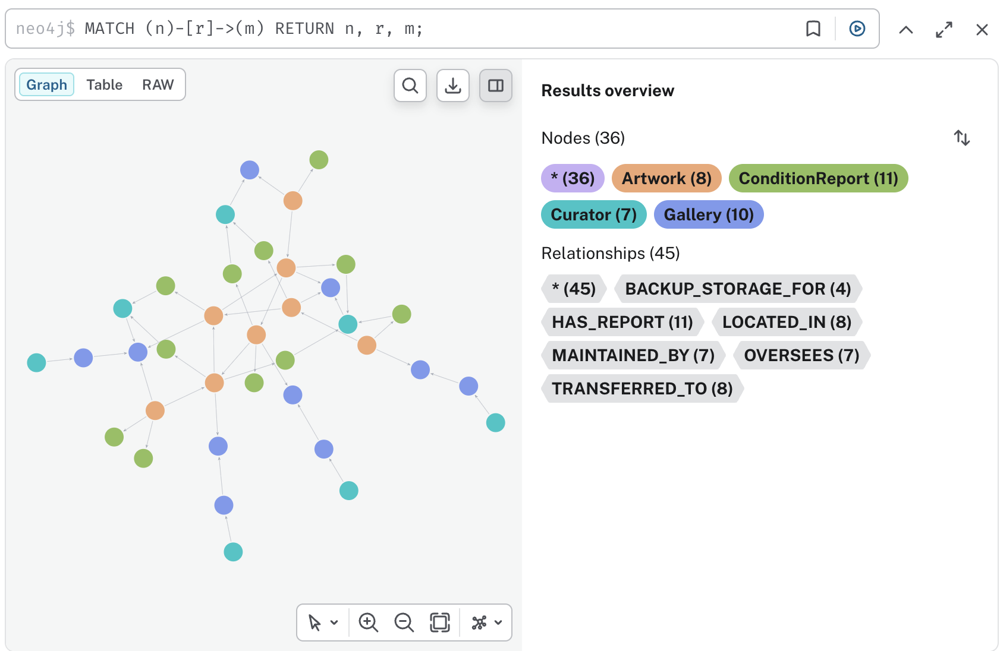
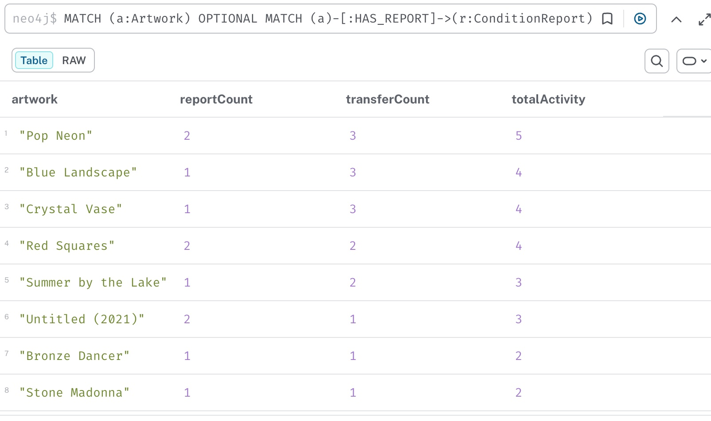

# Museum Collection Graph Database (Neo4j)

This project remodels a relational art-museum database as a Neo4j property graph. Six Cypher queries then answer multi-hop questions, which in SQL would need recursive queries or self-joins.

> Individual part (Part B) of the **7BDIN006W Big Data Theory & Practice** coursework, MSc Data Science & Analytics, University of Westminster (July 2026). Part A was a group business report and is not included.

**Tech stack:** Neo4j · Cypher (variable-length paths, `OPTIONAL MATCH`, aggregation) · Oracle SQL (relational source)

<p align="center">
  
</p>

## Graph model

| Node label | Count | Properties |
|---|---:|---|
| `Gallery` | 10 | gallery_id, gallery_name, location, gallery_type, registered_on |
| `Artwork` | 8 | artwork_id, title, artist, creation_date, art_type, status |
| `ConditionReport` | 11 | report_id, report_type, report_value, report_time |
| `Curator` | 7 | curator_id, curator_name, shift |

| Relationship | Count | Meaning |
|---|---:|---|
| `(:Artwork)-[:LOCATED_IN]->(:Gallery)` | 8 | Where a piece is placed. The placement date is stored on the edge |
| `(:Artwork)-[:TRANSFERRED_TO]->(:Artwork)` | 8 | Loans, swaps and exhibition links, with type and date |
| `(:Artwork)-[:HAS_REPORT]->(:ConditionReport)` | 11 | Condition assessments |
| `(:ConditionReport)-[:MAINTAINED_BY]->(:Curator)` | 7 | Who acted on a report, with a note and timestamp |
| `(:Curator)-[:OVERSEES]->(:Gallery)` | 7 | Added to connect isolated curators and empty galleries |
| `(:Gallery)-[:BACKUP_STORAGE_FOR]->(:Gallery)` | 4 | Added to link archive spaces to the galleries they support |

**Totals: 36 nodes, 45 relationships.**

- The relational data left four galleries with no artworks and four curators with no maintenance notes. Because the brief required a connected graph, `OVERSEES` and `BACKUP_STORAGE_FOR` were added. They connect those nodes without changing any of the original data.
- The museum data is the teaching dataset that came with the coursework brief. It is not a real collection.

## Queries

The brief's set queries were written for a social-network dataset. Each one is adapted to the museum data here, plus one query of my own (Q6). The results are from the Neo4j Browser runs in the submitted report.

| # | Question | Technique | Result |
|---|---|---|---|
| Q1 | Which artworks take the most curatorial attention? | `OPTIONAL MATCH` and two-stage aggregation | *Pop Neon* scores 5 (2 reports + 3 transfer links); *Blue Landscape*, *Crystal Vase* and *Red Squares* score 4 each |
| Q2 | Which artworks reach the most others through transfers? | Variable-length path `[:TRANSFERRED_TO*1..2]` | *Crystal Vase* reaches 7 artworks within two hops; *Blue Landscape*, *Pop Neon* and *Red Squares* reach 5 each |
| Q3 | Which galleries generate the most monitoring? | Three-node path with aggregation | *Special Rotunda*: 3 reports across 2 artworks |
| Q4 | Which artworks are linked by a transfer and also by a shared curator? | Two patterns joined on a shared node | One pair: *Crystal Vase* and *Pop Neon* |
| Q5 | How much condition work goes into each art type? | Grouping with `count(DISTINCT …)` | Paintings: 4 reports, 2 curators. Installations: 2 reports and **0 curators**, so those reports were logged but never acted on |
| Q6 | What longer transfer chains exist? | Variable-length path `[:TRANSFERRED_TO*3..5]` | Chains of up to 5 hops, e.g. Bronze Dancer → Blue Landscape → Red Squares → Pop Neon → Crystal Vase → Blue Landscape |

<p align="center">
  
</p>

Screenshots of every query result are in [`images/`](images/).

## SQL vs graph

[`sql/ArtMuseumDB.sql`](sql/ArtMuseumDB.sql) is the relational version: 7 tables in Oracle SQL, with the same data.

- **Multi-hop questions favour the graph.** Following a transfer chain in SQL needs one more self-join on the transfers table for every extra hop, and the depth has to be fixed in advance. In Cypher it is one pattern, `[:TRANSFERRED_TO*3..5]`.
- **Flat questions favour SQL.** Set-based filtering, aggregation, reporting and strict integrity constraints remain SQL's strengths.

## How to run

1. Create an empty database in [Neo4j Desktop](https://neo4j.com/download/) or a free [Neo4j Aura](https://neo4j.com/cloud/aura/) instance.
2. Load the graph, then run the queries:

   ```bash
   cypher-shell -a neo4j://localhost:7687 -u neo4j -f museum_graph.cypher
   cypher-shell -a neo4j://localhost:7687 -u neo4j -f queries.cypher
   ```

   You can also paste the files into Neo4j Browser. Run `museum_graph.cypher` once only, because running it again creates duplicate nodes.

3. To check the build, run `MATCH (n) RETURN count(n)`, which should return 36, and `MATCH ()-[r]->() RETURN count(r)`, which should return 45.

## Repository structure

```
museum_graph.cypher   builds the 36-node, 45-relationship graph
queries.cypher        the six analysis queries and a whole-graph view
sql/ArtMuseumDB.sql   the relational source (Oracle SQL)
images/               Neo4j Browser screenshots: the full graph and each query's results
```

## Limitations

- A teaching-sized graph (36 nodes), so the queries show technique rather than performance at scale.
- Q6 forbids repeating a relationship but not a node. The four transfers Blue Landscape → Red Squares → Pop Neon → Crystal Vase → Blue Landscape form a cycle, so the 5-hop "chains" go round it (the example above ends where it began). `ORDER BY hops DESC` with `LIMIT 10` also leaves the order of equal-length chains to the database.

## Verification note

On 20 October 2026 the build script was parsed and the six queries were re-implemented in plain Python over the same nodes and edges (Neo4j semantics: no repeated relationship within a path). The results match the table above: Q1 scores, Q2 reach (Crystal Vase 7; Blue Landscape, Pop Neon, Red Squares 5), Q3, the single Q4 pair, Q5 counts, and Q6 (16 paths of 3–5 hops, the longest 5 hops).

On 14 October 2026 the scripts were checked statically. The check confirmed the node and relationship counts per label and type, and that every `MATCH` in the build script refers to an ID that exists. The queries were not re-executed. The only local Neo4j server is an Enterprise build that requires a licence-agreement acceptance before it will start, so the results above come from the screenshots in the original submission. The section headings of the original script were turned into `//` comments so that the files run as-is in `cypher-shell`.
